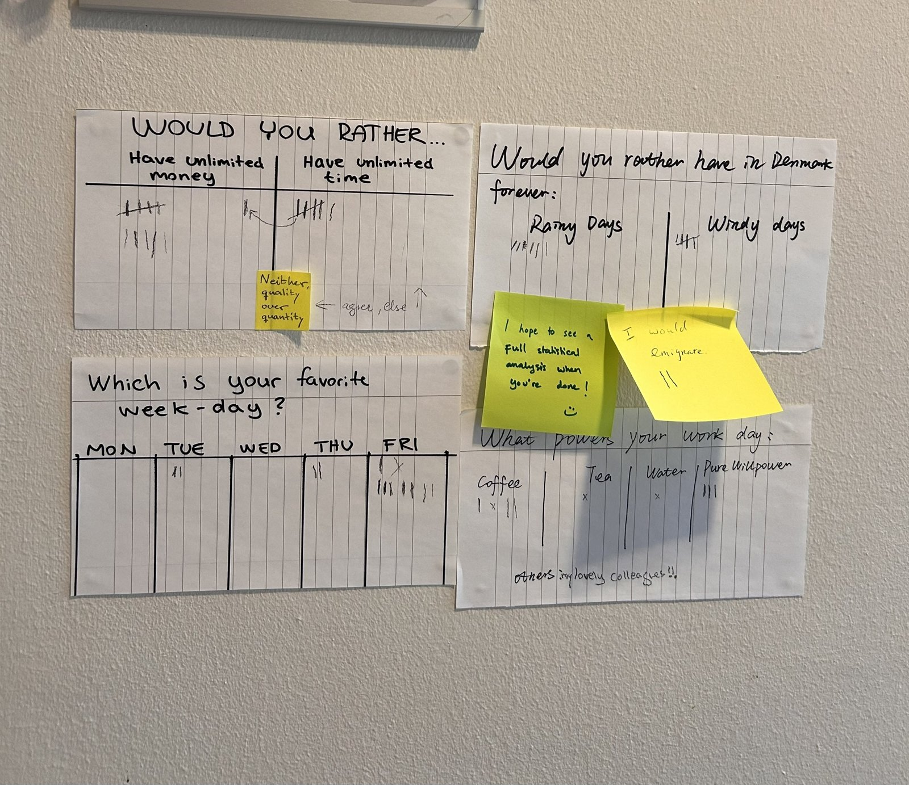
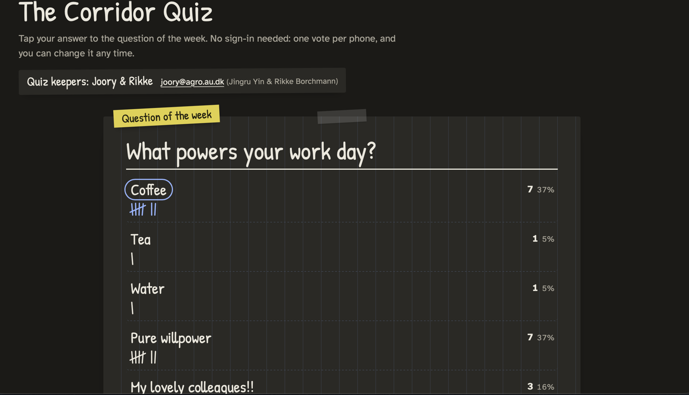

# The Corridor Quiz

A lightweight voting website for a weekly office "question of the week" in the Climate and Water section, Department of Agroecology, Aarhus University. Colleagues scan a QR code on the corridor whiteboard, vote on their phone without creating an account, and suggest new questions. The quiz keeper manages everything from the website itself.

## Background

It started on paper, right outside my office in the Climate and Water section, next to a corridor table where colleagues work on a shared jigsaw puzzle. My office mate, Rikke Borchmann, wrote a "would you rather" question on a sheet of paper, taped it to the wall and left a pencil for people to answer with tally marks. I mentioned how much I enjoyed it, and soon a second question appeared. I couldn't resist joining in with two more. Colleagues stopped by, added their tallies, argued on sticky notes ("Neither, quality over quantity"), and one even asked for "a full statistical analysis when you're done".



Seeing how much people wanted to join in, René Larsen suggested a whiteboard to our research group coordinator, Friederike Malisch-Johnigk, and she was up for it. My idea was to make the whiteboard a space for anyone who has something to say: a quiz to answer, a note, a doodle or a thought. Together with the puzzle table, the corridor became a small community corner where people pause for a minute and leave a mark.

To make the quiz part easier to join, I wanted to bring it online. The week before, while preparing for a potential job interview, I had a session with Mohammed Farhan, database developer and manager at our department. He walked me through the basics: designing tables, relating them with foreign keys, knowing when to normalise, and the pattern of *database ← API ← client (website)*. That gave me the confidence to try it for real.

When I started, Claude (the AI assistant I worked with) suggested easier routes, such as an online form or a ready-made poll page. I chose to build it with a proper database instead, so I could practise what I had just learned. In this project, Supabase (PostgreSQL) is the database, a set of SQL functions acts as the API, and the website is the client.

The website keeps the look of the paper polls (ruled cards, hand-drawn tally marks, sticky notes) and adds anonymous phone voting, a suggestion box anyone can use, and running statistics. Votes written on the whiteboard still count: they're added to the online totals.

The website went live on 26 November 2026. Only afterwards did I realise it was Thanksgiving Day, a happy coincidence, and a good excuse to thank the colleagues who made the corridor a friendlier place and everyone who helped this idea grow.

**Live site:** https://klima-corridor-quiz.netlify.app



## Features

- **Anonymous voting, one vote per device.** Voters need no sign-in. Each phone has one vote per question, and people can change their vote. Results appear only after voting, to avoid bias.
- **Paper and digital tallies combined.** Votes written on the whiteboard are added to the online votes, so the two channels give one result.
- **Suggestion box.** Anyone can submit a question with 2–6 answers. The server checks the input and limits each device to 3 suggestions per day.
- **Keeper mode.** One password-protected admin view for posting questions, choosing the question of the week (or picking one at random), adjusting whiteboard tallies and taking content down.
- **A live statistics panel.** Total tallies, the clearest verdict and the closest race, recalculated as votes come in.
- **Hand-drawn look.** Tally marks drawn as SVG, ruled-paper cards and sticky notes, matching the original paper polls. Works on phones and in dark mode.

## How it works

| Layer | Technology |
|---|---|
| Frontend | One static HTML file with vanilla JavaScript and CSS (no build step) |
| Database | Supabase (PostgreSQL) |
| Hosting | Netlify |

The browser only uses the public Supabase key, so the database protects itself:

- **Row Level Security** is on for every table. Visitors can read questions but can't touch the `votes` table directly.
- **All writes go through PostgreSQL functions** (`security definer`) that validate their input: `cast_vote`, `suggest_question`, and the `keeper_*` admin functions.
- **The keeper password is stored as a bcrypt hash** (`pgcrypto`) in a table no visitor can read. Every admin function checks it on the server before changing anything.
- **Totals are computed in SQL** (`results()`), so individual votes are never sent to the browser.

## Project structure

```
index.html                     the whole website
sql/schema.sql                 database setup: tables, policies, functions, starting questions
sql/update-1-suggestions.sql   migration: suggestion box
sql/update-2-keepers.sql       migration: keeper mode and password
docs/KEEPER-GUIDE.md           how to run the quiz week to week
docs/vote-qr.png               QR code for the whiteboard
docs/paper-wall.jpg            the original paper polls
docs/screenshot.png            the live website
```

## Run your own copy

1. Create a free Supabase project and run `sql/schema.sql` in the SQL Editor. Change `CHANGE-ME` to your own keeper password first.
2. Put your Supabase Project URL and publishable key at the top of the script in `index.html`.
3. Deploy `index.html` to any static host, for example Netlify Drop or GitHub Pages.

## Credits

The paper quiz was started by Rikke Borchmann. The website was designed, built and is maintained by Jingru Yin (Joory), with help from Claude (Anthropic) as an AI coding assistant.
